# ContentSkills

Complete set of AI agent skills for content creation, including AI video editor, writing scripts, storyboard,
scheduling to social media, and setting up DM automations to drive sales.

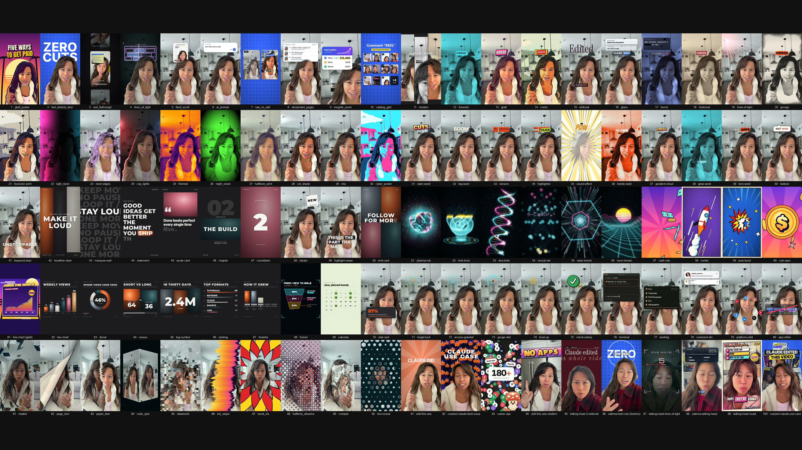

<table>
<tr>
<td><video src="https://github.com/user-attachments/assets/149e3696-3a25-4556-acd2-c43e0c1fb3ca" controls></video></td>
<td><video src="https://github.com/user-attachments/assets/f262ba4e-1462-467f-b69c-c5422015d6f6" controls></video></td>
<td><video src="https://github.com/user-attachments/assets/91ab3a73-bae9-485a-a6c3-ada4370a9d89" controls></video></td>
</tr>
<tr>
<td>One raw take, edited by Claude</td>
<td>20 effects from the library</td>
<td>Faceless: a script, a free voice and a narrator</td>
</tr>
</table>

## Install

ContentSkills works with any AI agent - Claude Code, ChatGPT Codex, Grokbot, Hermes, Cursor, OpenClaw, Gemini CLI,
GitHub Copilot and more.

To install it, just tell your AI agent:

```text
setup https://github.com/blotato/contentskills
```

As a Claude Code plugin: `/plugin marketplace add blotato/contentskills`, then
`/plugin install contentskills --marketplace blotato/contentskills`

## How to use it

Open Claude Code in the `~/contentskills` folder and ask. Drag a video into the chat when a prompt needs one.

| To | Say |
| --- | --- |
| Write a script | `write a 30-second script about Claude Code` |
| Make a video | `make a faceless video on this topic: Claude Code` |
| Edit a video | `edit this video` |
| Edit a video in a style you like | `edit this video based on this style: <paste Instagram reel URL>` |
| Add an effect | `add the spatial windows effect behind me` |
| Post to social media | `post this video to Instagram and TikTok` |

> [!IMPORTANT]
> **Your videos live in the dashboard: http://localhost:4600/dashboard/**
>
> Open it in your web browser (Chrome, Safari or any other). It shows every video you have made, the storyboards
> waiting for your approval and the full effects library. If the page does not load, say **"open my dashboard"** and Claude starts it and gives you the right link (it can be
> a slightly different number, like 4601, if another app is using 4600).

Claude sends a link to a storyboard before it makes a video. Press **Make my video** to approve, then mark any changes
on the review page.

In the video editor, you can still make edits.

Click on any scene and tell AI what you want to change.

Click “Screenshot” and AI can “see” your scene. No more copy pasting screenshots into your terminal/agent :)

This all runs locally on your computer, consuming only tokens, using any AI agent. There are no expensive “credits”.

And every scene edit runs in PARALLEL - this means you can give feedback on one scene, let Claude/Agent edit it, while
you’re providing feedback on another scene. Just this saves HOURS.

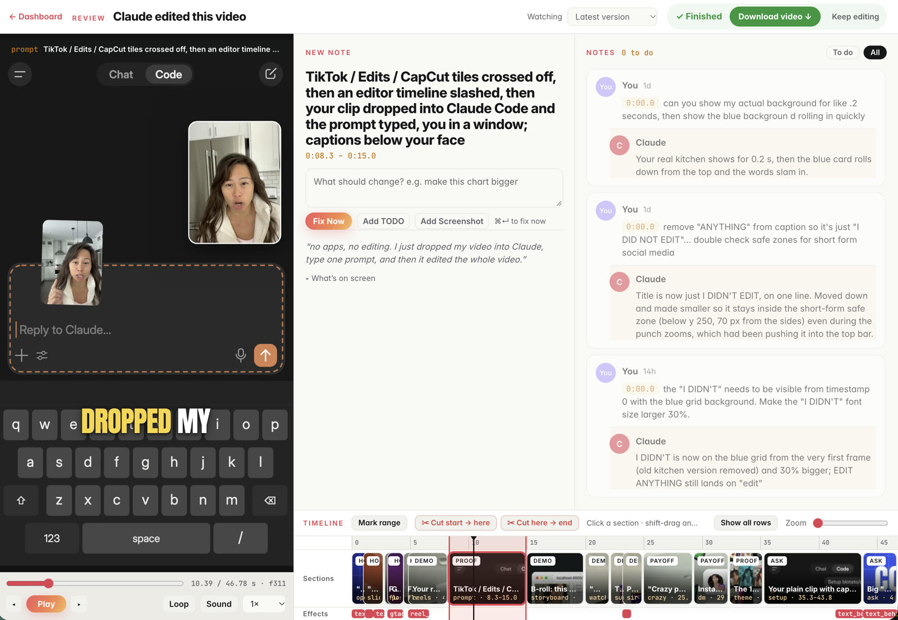

More prompts, effects, themes and settings: [docs/GUIDE.md](docs/GUIDE.md). For developers: [docs/REFERENCE.md](docs/REFERENCE.md).

## What's included

**Themes**

| Preview | Theme | Look |
| --- | --- | --- |
| 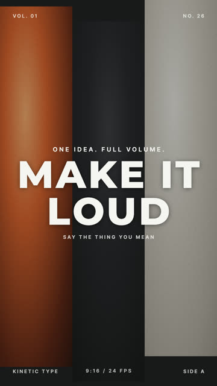 | `modern` (default) | Fast editorial opener: charcoal canvas, full-bleed vertical pictures, bold type, colour from the footage. |
| 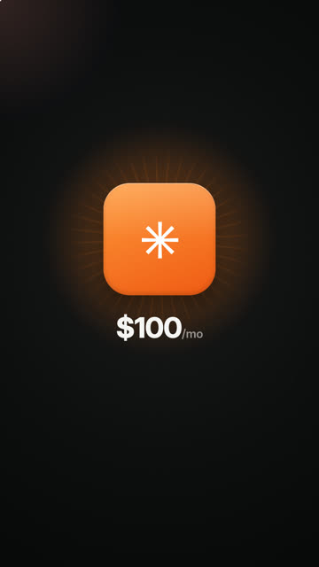 | `minimal` | Quiet product-launch explainer: one object centred on a near-black canvas, one line of text. |
| 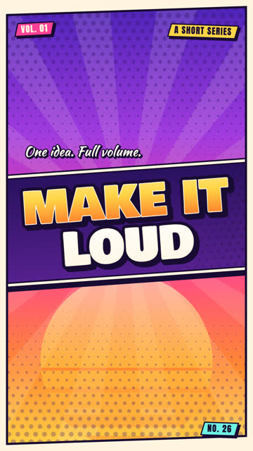 | `gta6` | Comic-panel coastal sunset: angled panels, pink-to-orange skies, inked outlines. |
| 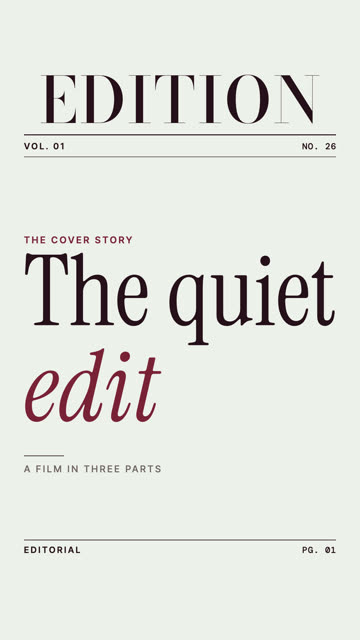 | `editorial` | Magazine page: daylight paper, aubergine ink, a condensed serif with an italic accent word, hairline rules. |
| 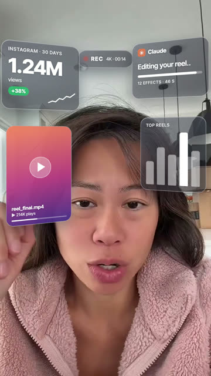 | `glass` | Frosted glass for fast, professional edits: milky or smoked glass cards with big rounded corners. |
| 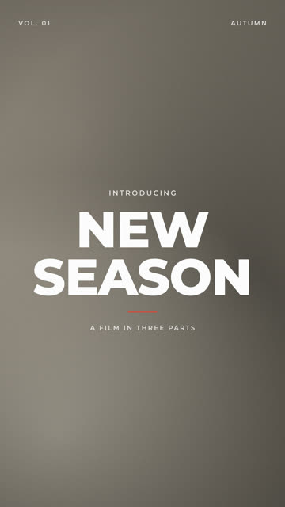 | `fashion` | Fashion film: the footage carries everything, one short white word at a time. |
| 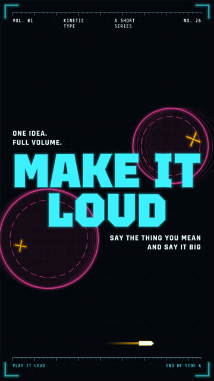 | `futuristic` | Sci-fi interface: thin glowing line-work, notched frames, corner brackets, mono readouts in cyan. |
| 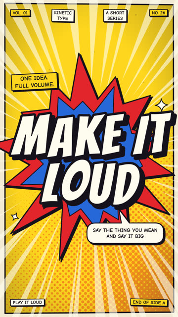 | `comic` | Print comic: flat primary colours, halftone dots, thick ink, bursts and speech balloons. |
| 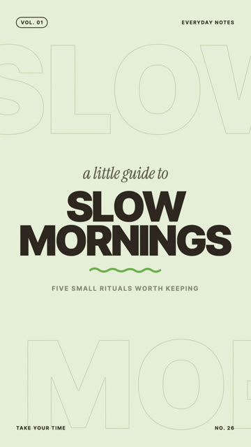 | `lifestyle` | Bright and airy: mint-cream paper, warm ink, one fresh green, handwriting accents. |
| 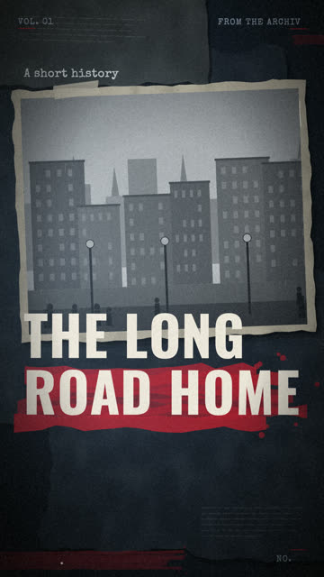 | `historical` | Archive documentary: black-and-white photographs on torn paper, maps and timelines, old-film wear. |
| 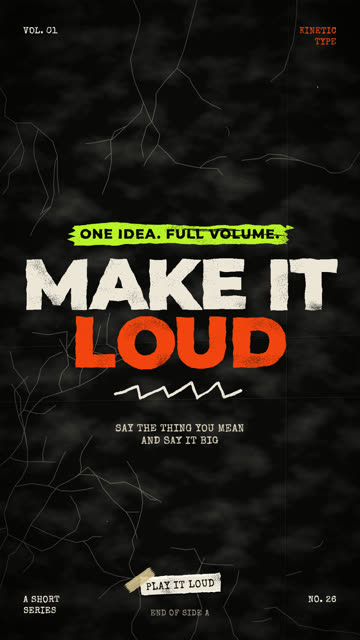 | `grunge` | Photocopied street poster: soot black and bone paper, torn edges, tape, stamps, marker scribbles. |
| 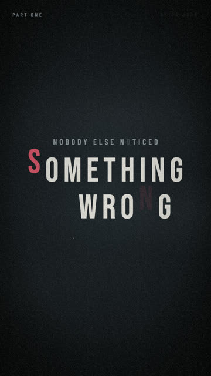 | `horror` | Horror title sequence: near-black slate, bone-white condensed capitals, grain and flicker. |
| 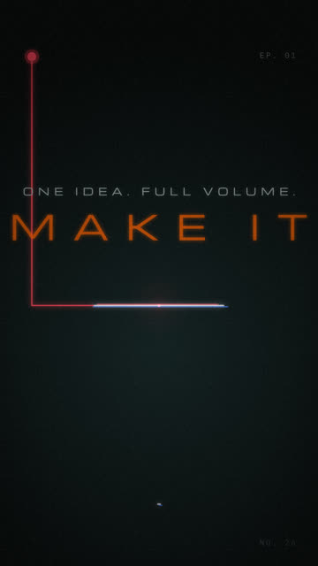 | `lines-of-light` | Thin neon lines on near-black and deep teal haze, each with a red and blue echo. |

**Effects**

| Preview | Effect | What it does |
| --- | --- | --- |
| 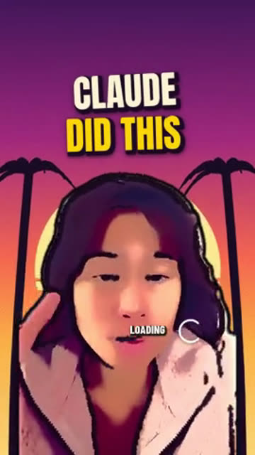 | `gta6_poster` | Turns you into a game-cover poster with the hook in bold type, then snaps back to live. |
| 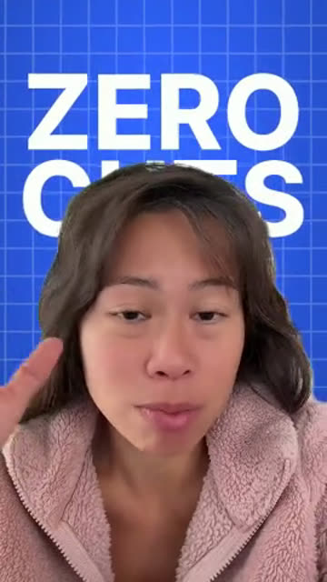 | `text_behind_slice` | Big title behind you on a colour card; a cut line slices it and the halves slide apart. |
| 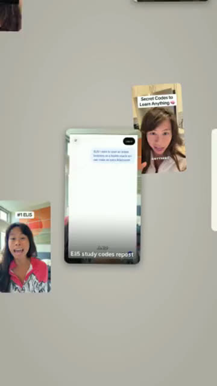 | `reel_flythrough` | The shot shrinks into a card and the camera flies through playing reels. |
| 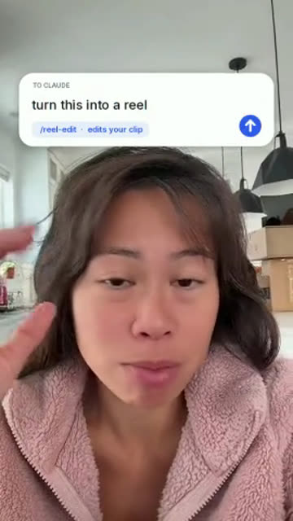 | `ai_prompt` | A chat box above your head types the ask as you say it, then sends it. |
| 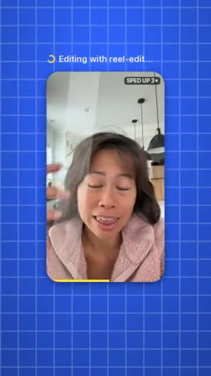 | `edit_preview` | The shot shrinks into an "Editing with…" card and plays sped up with a progress line. |
| 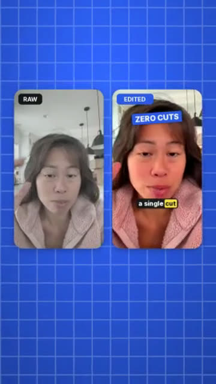 | `raw_vs_edit` | Raw and edited cards play the same moment side by side; the edited one grows to full screen. |
| 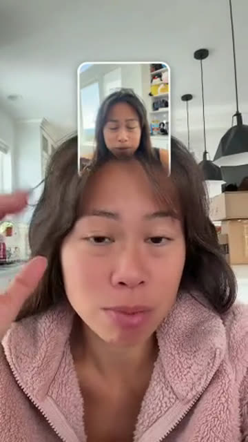 | `feed_scroll` | A phone card above your head swipes through reels, each with its view count. |
| 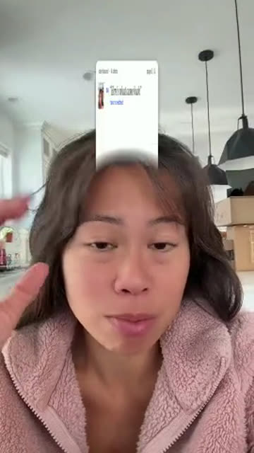 | `storyboard_pages` | Storyboard pages above your head, a thumbnail and a line per shot; the pages flip. |
| 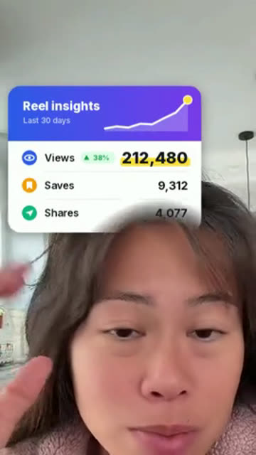 | `insights_zoom` | A reel-insights card slides in, the numbers count up and the camera pushes into the views. |
| 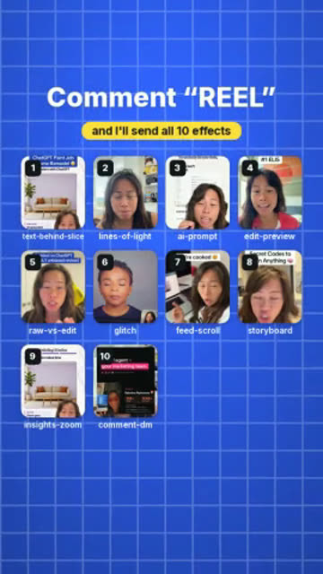 | `catalog_grid` | End card: "Comment KEYWORD" over a numbered grid of reels that fills in tile by tile. |
| 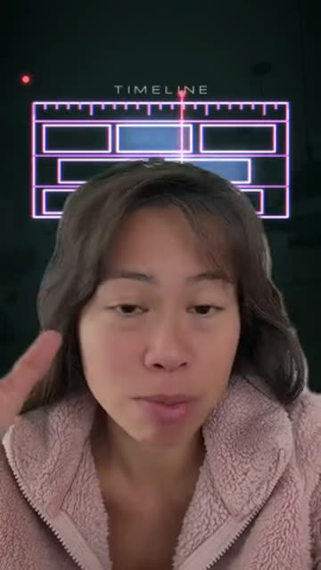 | `lines_of_light` | The room goes dark and thin neon lines draw an editing timeline behind you. |
| 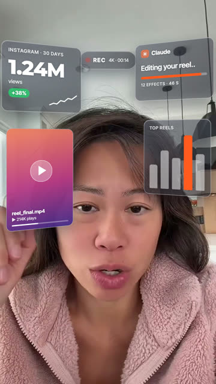 | `spatial-windows` | Frosted glass windows float in the air around you, some behind you, with live stats and charts. Works in every theme. |
| 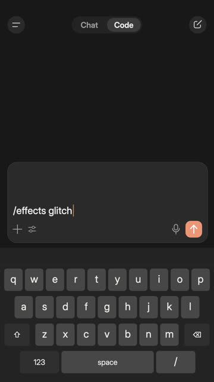 | `composer` | Claude app: your clip attached, the slash command typed on the keyboard with autocomplete. |
| 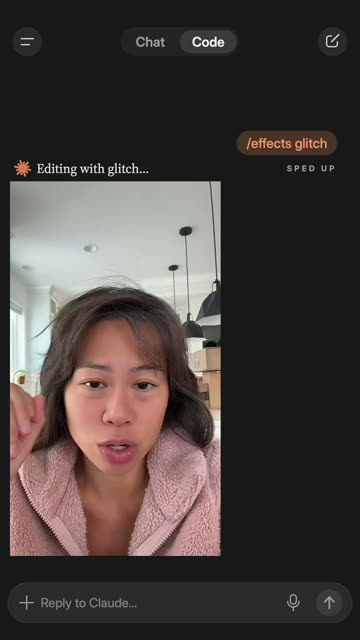 | `chat` | Claude app: your command as a pill, the spinning spark and "Editing with…", then the reply. |
| 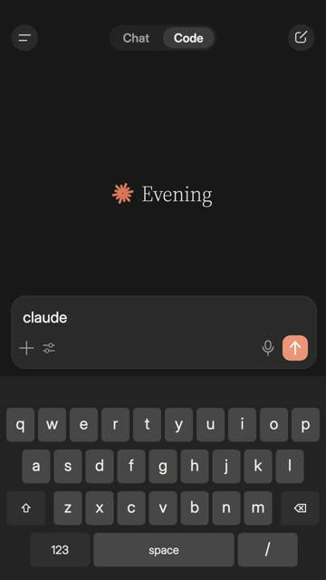 | `greeting` | Claude app: a new chat where a short message is typed key by key and sent. |
| 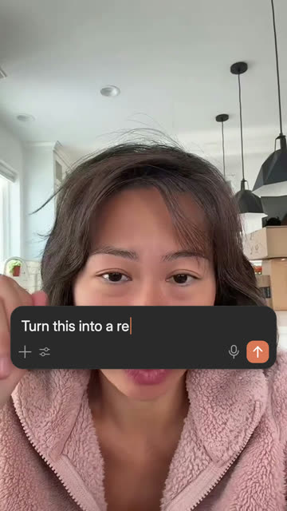 | `prompt` | Claude app: the composer as a floating card, the prompt typing letter by letter. |
| 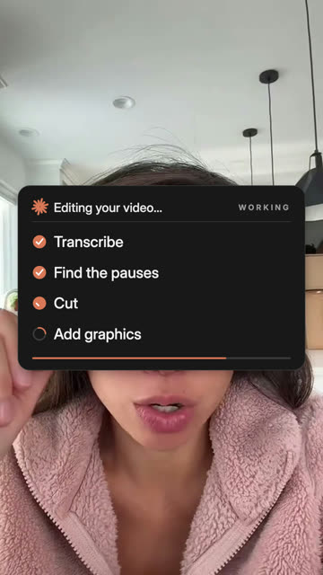 | `worklog` | Claude at work: a dark card listing the steps of the job, each one lighting up as it finishes. |
| 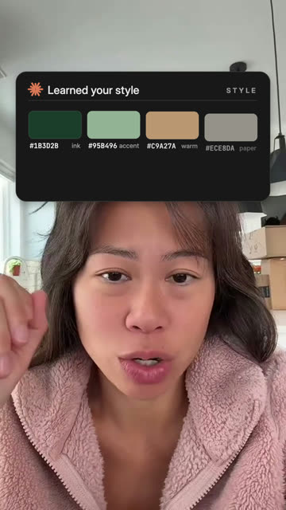 | `style-scan` | Claude learning a style: reel covers stream into the spinning spark. |
| 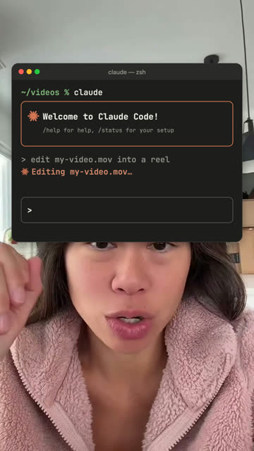 | `terminal` | Claude Code in a terminal window: `claude` is typed and the request goes in. |
| 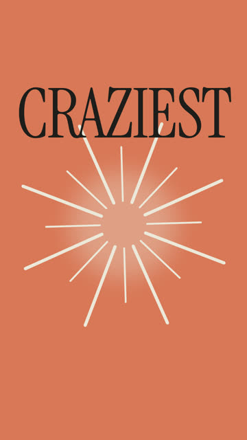 | `edit-hook` | Opening hook: an "editing your video…" status pill above your head, then the title slams in. |
| 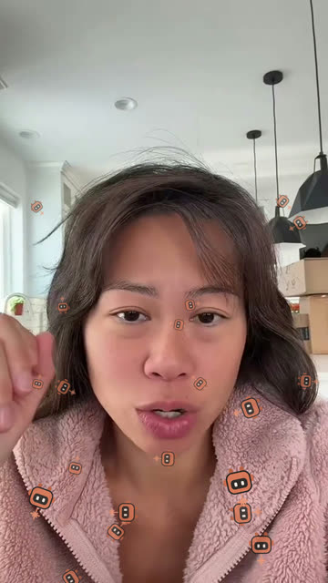 | `agent-rain` | Little Claude agents tumble down over the picture. |
| 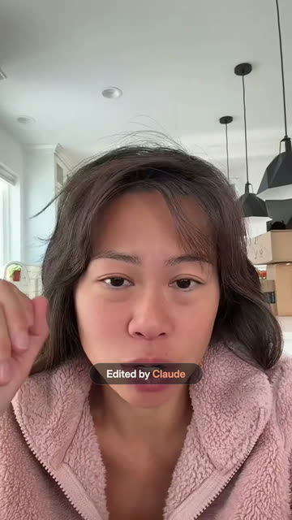 | `stamp` | A small "Edited by Claude" pill on a full-screen result. |
| 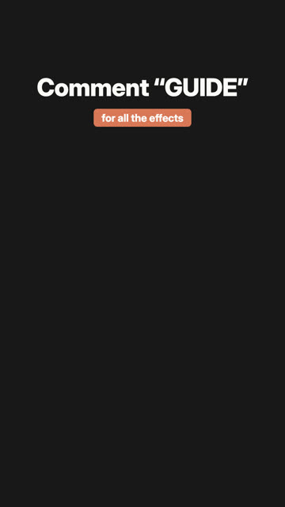 | `endcard` | Claude answers the comment keyword and a card of results resolves from pixels. |
| 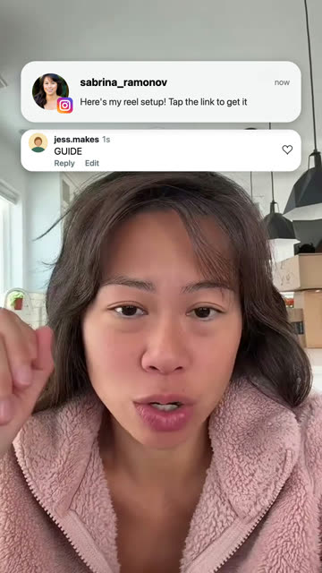 | `comment-dm` | Instagram: a viewer comments your keyword, then your auto-DM arrives. |
| 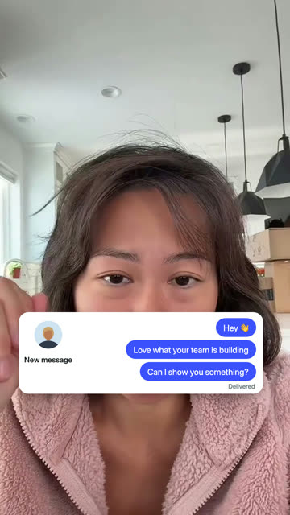 | `dm-send` | Instagram: a message thread where your outgoing messages pop in one after another. |
| 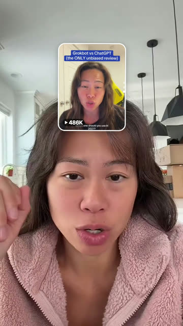 | `feed-scroll` | Instagram: a phone card swipes up through your reels, each with its view count. |
| 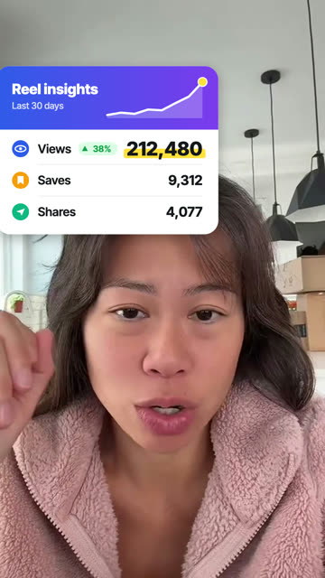 | `insights-zoom` | Instagram: a reel-insights card with numbers counting up and a highlighted stat. |
| 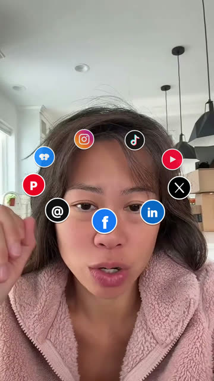 | `platform-orbit` | Nine platform badges spin in a tilted ring around your head. |
| 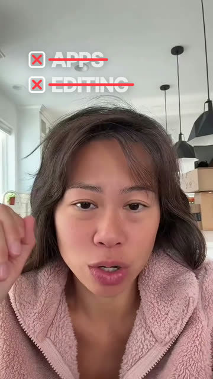 | `strike-checklist` | Big uppercase items above your head, each crossed out in red on its cue. |
| 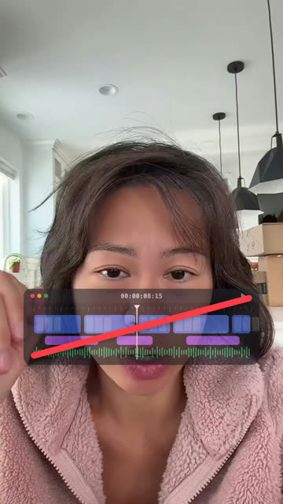 | `app-strike` | Editing-app tiles pop in and get red crosses. |
| 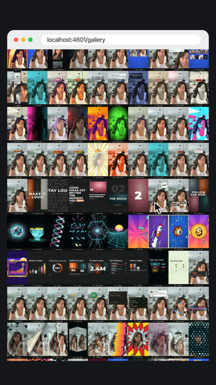 | `screen-scroll` | A browser window scrolls down a tall screenshot with a cursor, like a screen recording. |
| 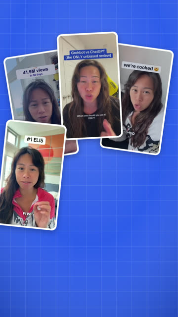 | `proof-deck` | Stills from the finished edit are dealt like tilted cards behind you. |
| 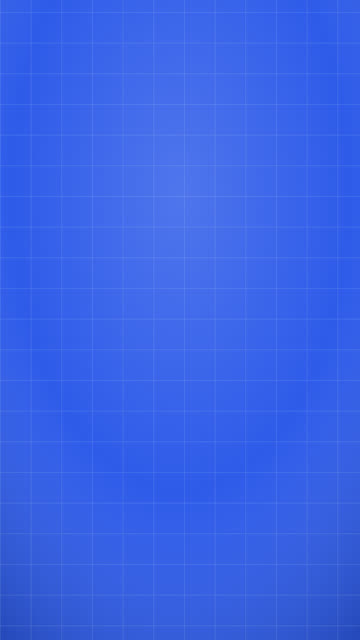 | `backdrop` | An accent-colour background with soft top-light and a drifting grid. |

**Everything else**

| | |
| --- | --- |
| **Light and filters** | cop_lights, cel_shade, color_grade, light_neon, light_golden_hour, halation |
| **Captions** | slam-word, panel-pop, heavy, one-word, letter-stagger, top-line |
| **Text** | headline-slam, marquee-wall, quote-card, countdown, end-card |
| **3D** | coin-spin, cash-rain, palm-horizon, sunset-drive, frame-corridor, panel-ring |
| **Charts** | bar-chart, donut, big-number, ranking, funnel, line-chart |
| **Transitions** | page_turn, ink_swipe, zoom_through, swing_doors, tile_flip |
| **Sounds** | 29 sound effects, all synthesized |
| **Pipeline** | Cut, find your face, plan, render, check. Local voice and transcription, so the default path costs nothing. |
| **Your style** | Your colours, fonts and captions, remembered for every next video. |
| **Writing and posting** | brand-brief, post-writer, post-grader, viral-hooks, repurpose, post-scheduler |

Browse it all playing live on the dashboard.

### Project layout

```text
contentskills/
├── AGENTS.md            Instructions for every coding agent. CLAUDE.md and GEMINI.md just import it.
├── skills/              The agent skills, one folder each with a SKILL.md (also linked as .claude/skills)
│   ├── setup/             "setup blotato/contentskills": checks tools, runs npm run setup, opens the dashboard
│   ├── make-video/        The video playbook: faceless videos, talking-head edits, storyboards, re-makes
│   ├── quality-check/     Checks a finished video and keeps fixing it until it passes
│   ├── generate/          Optional paid AI footage through kie.ai
│   └── content-coach/, brand-brief/, post-writer/, post-grader/,
│       viral-hooks/, repurpose/, post-scheduler/    Writing and posting (posting goes through Blotato)
├── pipeline/            The engine (Node and Python): cut, transcribe, find faces, voice, render,
│   │                    combine, check, patch one section, undo. Every npm run command lives here.
│   ├── storyboard/        The storyboard page you approve before anything renders
│   ├── review/            The review page where you pause the video and mark changes
│   └── draft/             The quick preview player
├── library/             Everything that ends up on screen
│   ├── themes/            One folder per look (13 themes): captions, text, effects,
│   │                      transitions, D3 charts, Three.js 3D, Lottie, overlays and fonts.
│   │                      BUILDING-A-THEME.md explains how to add one.
│   ├── _shared/           Used by every theme: caption engine, placement and the app safe zone,
│   │                      light and filter effects, signature effects, shader transitions,
│   │                      sound effects, presenters (the mushroom narrator), common charts and 3D
│   ├── ui/                Look-alike app screens: Claude, Instagram, reel kit
│   ├── voiceover/         The free voices, with samples
│   └── models/            Small on-device models for face detection and cutting you out of the background
├── templates/           Reusable video structures (for example "compare"), independent of the theme
├── examples/            Two complete projects to learn from: faceless-ai-voice and talking-head
├── dashboard/           The local web app: dashboard, My videos and the gallery (npm run link opens it)
├── gallery/             Finished reels and the showcase sheet at the top of this page
├── settings/            defaults.json, plus user.example.json as the template for your own settings
├── style/               profile.example.json, the template for your look and learnt tastes
├── docs/                GUIDE.md (for users) and REFERENCE.md (storyboard formats, every command)
├── .claude-plugin/      Claude Code plugin and marketplace manifests
├── plugin.json          Codex plugin manifest
└── .grok-plugin/        Grok plugin manifest
```

Created on your computer, never committed:

```text
├── projects/<name>/     One folder per video: storyboard.json, voice, renders, out/cut.mp4,
│                        earlier versions (cut-v<n>.mp4) and final.mp4
├── settings/user.json   Your name, handle and preferences (written during setup)
├── style/profile.json   Your colours, fonts, captions and the notes Claude learnt from you
└── .tools/              Downloaded by npm run setup: voice and transcription models,
                         Python environments and a headless browser
```

## License

The code is licensed under the GNU Affero General Public License, version 3 only (`AGPL-3.0-only`); see [LICENSE](LICENSE).
Fonts, models and other third-party files keep their own licences. The licence covers the code, not the videos you make
with it, and it gives no rights in media you bring yourself.
