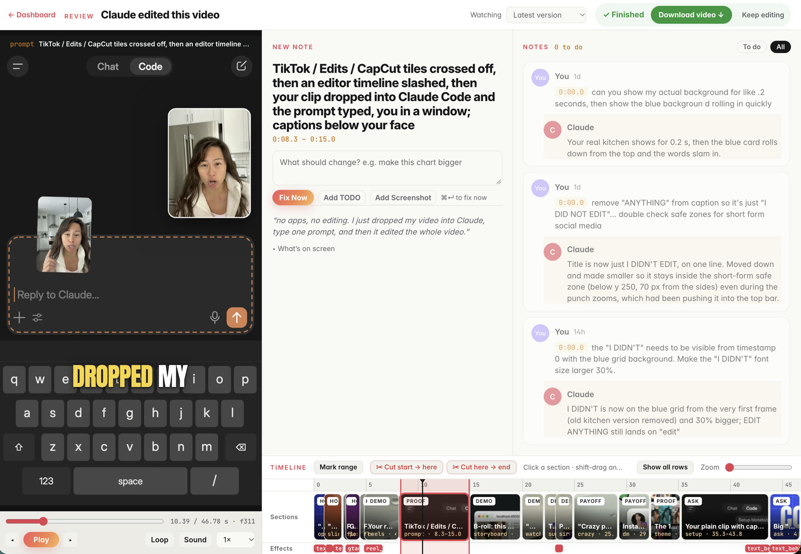
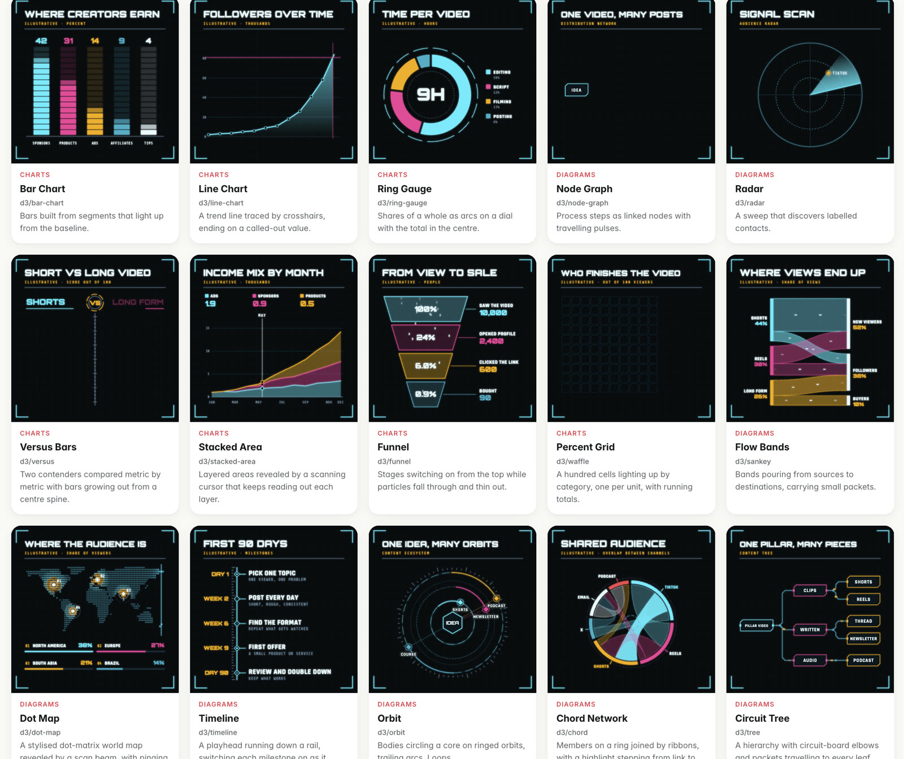
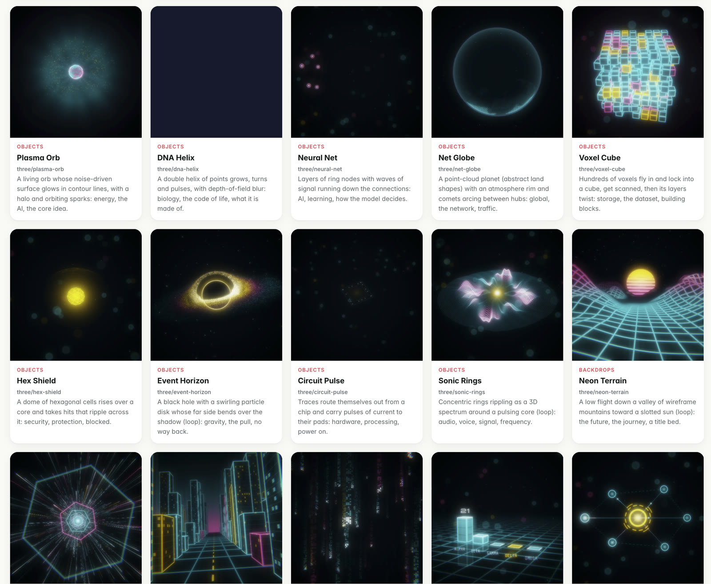
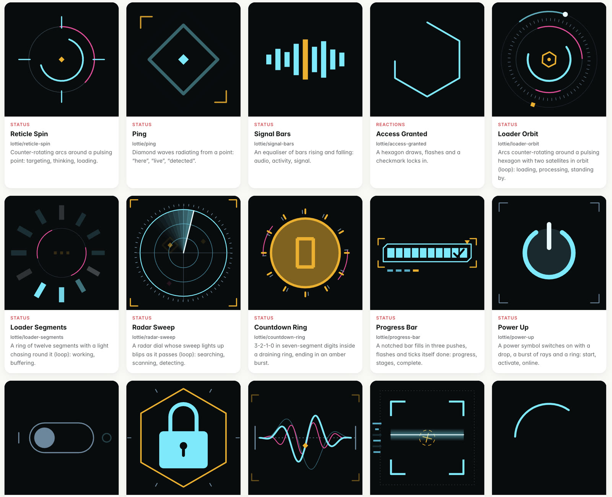

# ContentSkills guide

Everything beyond the README: more prompts, how a video gets made, the library, your settings, Windows and Linux.

## How it works

Every video takes four steps.

1. **Ask.** Tell Claude what you want (examples below).
2. **Approve the plan.** Claude sends a link to a **storyboard**: a phone-size preview, one panel per scene.
   👍 the scenes you like, press ✎ Change on the ones you don't and say why. When it looks right, press **Make my video**.
3. **Fix.** Watch the video on its **review page**. Pause anywhere, type what's wrong (*"captions smaller"*), and press
   **Make a new version**. To cut a bit out, pause there and press **✂ Cut start → here** or **✂ Cut here → end**.
4. **Finish.** Press **Finish video ✓**. The video downloads.

The folder has five parts:

| Folder | What it is |
| --- | --- |
| `projects/` | Your videos, one folder each. |
| `library/` | The parts: themes (whole looks), effects, captions, charts, app screens, sounds and music. |
| `pipeline/` | The machine that builds a video: cut, find your face, plan, render, check. |
| `templates/` | Ready-made video formats you can reuse. |
| `style/` | Your personal look (colours, fonts, captions). It learns from your notes. |

### Best results: give Claude a reference style

Give Claude a **reference**: any Instagram Reel (or TikTok, or Short) whose look you like. Paste its
link and add it to your request:

> *Edit ~/Downloads/take1.mov in this style: https://www.instagram.com/reel/…*

Claude downloads the reel, goes through it frame by frame and measures it: the colour grade, the fonts, how the captions
look and where they sit, how the title is set, how often it cuts and how fast things land. Your video then gets that look.
Without a reference Claude uses the default theme.

- **Any reel works**, not only edits like yours: a podcast clip, a style reel, a tutorial. Pick it for the *look*.
- **Long reel?** Say which part matters: *"just analyze the first 15 seconds"*.
- **Instagram usually needs a login.** Claude will ask before using your browser's Instagram login (it stays on your
  computer). Or save the reel to Downloads and give Claude the file instead of the link.
- **A reference sets the style, nothing else**: colours, type, captions and pace. The other creator's graphics,
  logos and words are never reused. Your own rules still win (no text on your face, captions out of the app's buttons).
- **Keep it for next time**: *"make this my style"* turns the reference into your default look for every video.

## Things to ask Claude

**Start a video**

- *Edit ~/Downloads/take1.mov in this style: <reel link>*
- *Make a video from ~/Downloads/take1.mov* — your talking video (use your file's name and where it is; `~/Downloads` is
  your Downloads folder). Claude cuts the pauses and ums, adds captions and graphics on your words.
- *Make a 30-second video about 5 ways creators make money* — no camera: Claude writes the script, adds a free voice and a visual for every line.
- *Make a video from ~/Downloads/take1.mov in the gta6 theme* — pick a whole look. Themes: modern (the default),
  minimal, gta6, editorial, glass, fashion, futuristic, comic, lifestyle, historical, grunge, horror and lines-of-light.

**Add something specific** (names are under each tile in the showcase)

- *Put text_behind_slice on the hook* — big words behind you, sliced on the beat.
- *Use gta6_poster when I say "five ways"* — turns you into a game poster for a moment.
- *Add the spatial windows effect behind me* — frosted glass windows float around you with live stats; it takes on
  the colours and fonts of whichever theme the video uses.
- *Show feed_scroll when I mention my best reels*
- *Add a bar chart of the numbers I say at 0:20*
- *Glitch on every cut* · *cel shade the whole video* · *add a vhs look to the intro*

**Fix things** (or type these as notes on the review page)

- *Captions smaller and lower* · *This card covers my face* · *Too many graphics in the middle* · *Make the hook punchier*

**Your look**

- *Make my style from this reel: <link>* — Claude takes its colours, type and pace as a style reference (never its graphics or words).
- *Hate the blue, never use it again* — notes about taste are remembered for every next video.

**Ready-made formats**

- *Make an effects showcase: me typing /effect text-behind-slice, /effect reel-flythrough … and the result of each*
- *Put my raw clip and the edited video side by side*

## Writing and posting skills

These skills (formerly in `blotato-skills`) are in `skills/`:

| Skill | Say something like |
| --- | --- |
| content-coach | "I don't know what to post." The front door: runs the others. |
| brand-brief | "Set up my brand." One-time: your business, customer, call to action and voice. |
| post-writer | "Write me a post about X for Instagram." |
| post-grader | "Is this post any good?" Scores a draft and lists the top 3 fixes. |
| viral-hooks | "Give me a hook for X." 100 proven hook frameworks. |
| repurpose | "Turn this blog post into a week of content." |
| post-scheduler | "Schedule this to LinkedIn." Posts through Blotato. |
| generate | AI-generated clips through kie.ai (a paid service). For videos made free on your computer, just ask for a video. |

## What's inside

**Prompt-based video editor.** Watch the video, pause anywhere, type what should change.



**D3.js charts and diagrams**



**Three.js 3D scenes**



**2D animations**



## Good to know

- **Free by default.** The voice, transcription and effects run on your computer. Paid voices (ElevenLabs) and posting
  are never used without asking you first.
- **Nothing is rendered until you approve the storyboard.**
- **Every video is checked** before you see it: no text on your face, nothing hidden under TikTok's or Instagram's
  buttons and captions, steady loudness, no frozen or black frames.
- **Old versions are kept.**
- **Browse everything** on the dashboard's **Library** and **Gallery** pages. It all plays live.

## Your settings

Nothing about you is written into the code. Two files hold it, and neither is committed:

| File | What it holds |
| --- | --- |
| `settings/user.json` | Who you are and how you like your videos. Copy `settings/user.example.json` and edit it, or just tell Claude ("my handle is @…", "make my voice a little louder") and it writes the file. |
| `style/profile.json` | Your look: colours, fonts, captions, grade and tastes learnt from your review notes. `style/profile.example.json` shows the shape; `npm run style` writes it from a reel you like. |

`settings/user.json` only needs the values that differ from `settings/defaults.json`:

```json
{
  "me": {"name": "Alex Rivera", "handle": "alexmakes", "role": "Founder · Example Co", "keyword": "GUIDE"},
  "audio": {"voiceLufs": -13},
  "style": {"cookiesBrowser": "chrome"}
}
```

- `me` fills in every graphic that shows a person: the name plate, the Instagram comment-to-DM card, the end card's
  "Comment …" line. A storyboard can still override any of them for one video.
- `audio.voiceLufs` is how loud your voice is made in every video (default −14 LUFS). `audio.music` and `audio.effects`
  set how far under your voice the music and sound effects sit.
- `captions.bottom` is where you like the caption line; `style.cookiesBrowser` is the browser whose Instagram login
  `npm run style -- from <url>` may use (empty until you choose one).

Set `CONTENTSKILLS_SETTINGS=/path/to/file.json` to use a different settings file for one command.

## Windows and Linux

**Windows**

- Use the Claude desktop app's **Code** tab, as above.
- If "Set me up" can't install a tool on its own, open **PowerShell** and run:
  `winget install OpenJS.NodeJS.LTS Gyan.FFmpeg astral-sh.uv`, then close and reopen the Claude app and say **Set me up** again.
- On Windows on ARM (Snapdragon laptops), setup installs the x64 Python by itself: the video tools have no ARM builds for Windows.

**Linux**

- There is no Claude desktop app for Linux. Use Claude Code in the terminal instead: install it with
  `curl -fsSL https://claude.ai/install.sh | bash`, then go into this folder (`cd` to it), type `claude` and say **Set me up**.
- If a tool is missing, install it with your package manager, e.g. on Ubuntu: `sudo apt install ffmpeg nodejs`
  (Node must be version 22 or newer) and `curl -LsSf https://astral.sh/uv/install.sh | sh`.
- The smooth shader transitions need OpenGL, which every desktop has. On a server without a screen, ask Claude to use
  other transitions.
