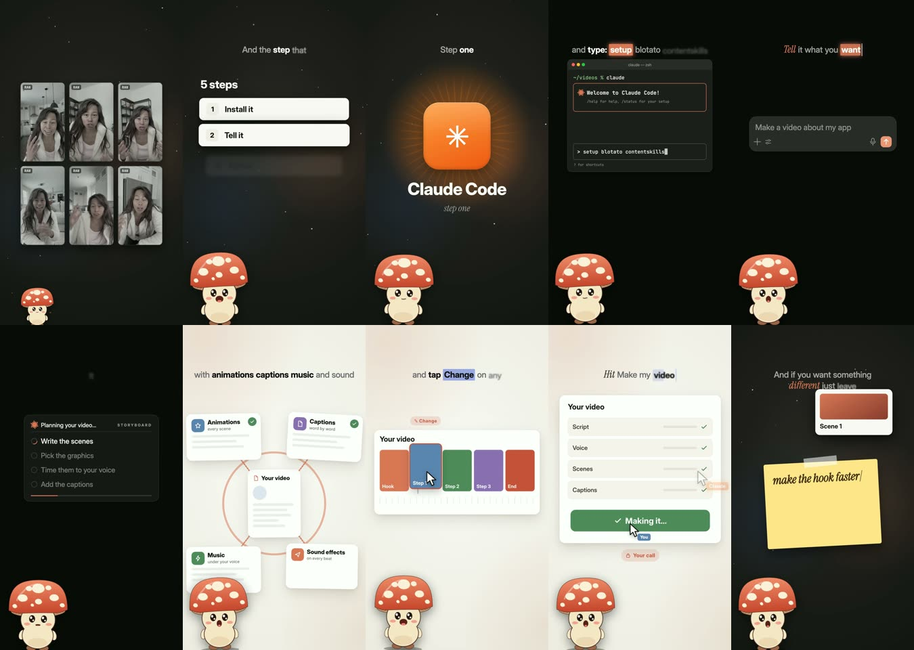
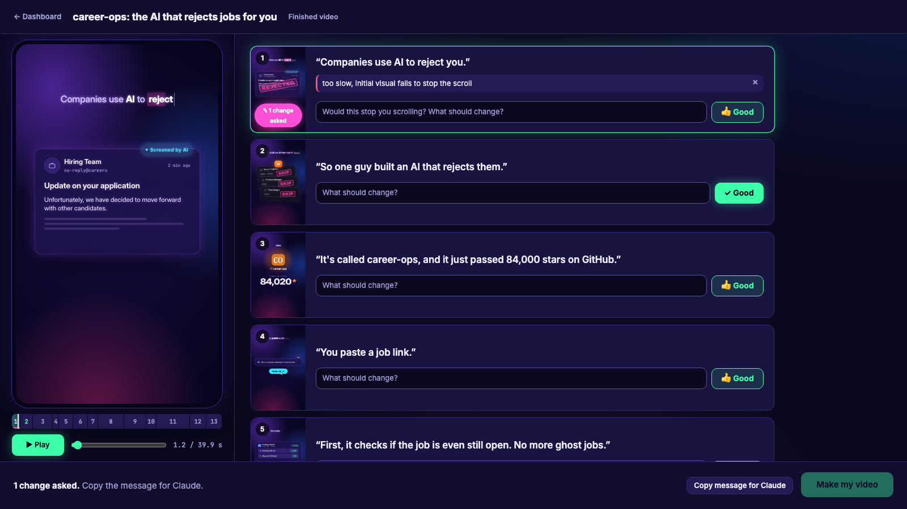
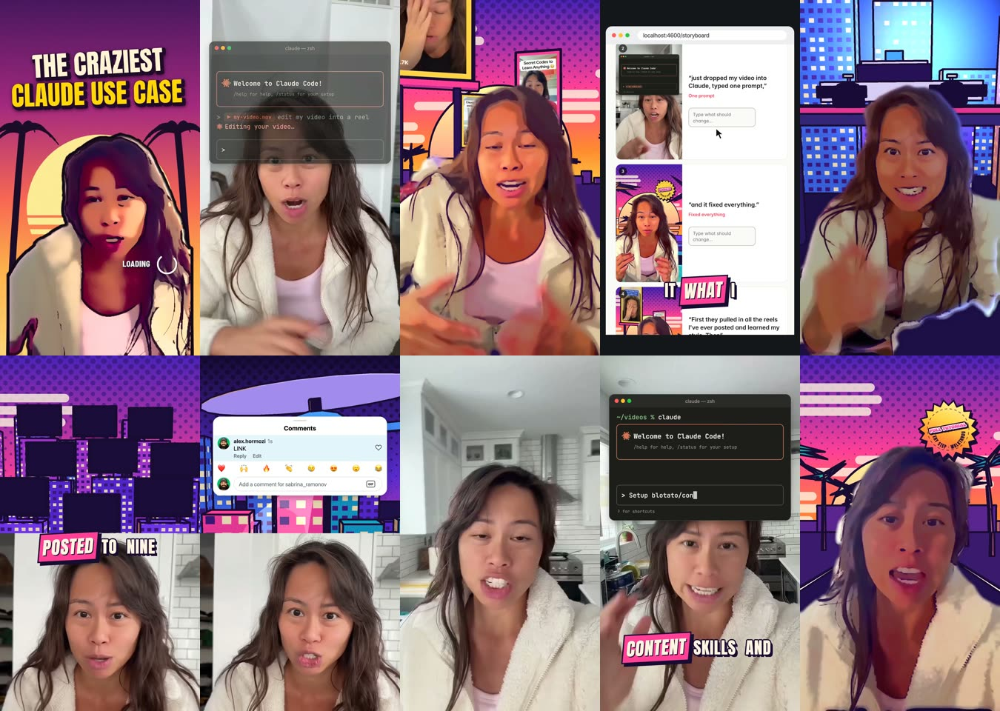

# ContentSkills reference

The technical reference: storyboard formats, pipeline commands, walkthroughs and checks. Paths are relative to the
repository root. The short introduction is in [README.md](../README.md).

## The pipeline

**1. Storyboard / script** — `projects/<name>/storyboard.json`. A list of shots. Each shot has the
line being said and several **candidates**: alternative library pieces that could illustrate it.
Write more candidates than you need; the rough draft is where the usable ones get chosen.

```json
{
  "title": "Five ways creators earn",
  "captions": "box-highlight",
  "voice": {"provider": "kokoro", "voice": "af_maple", "speed": 1.0},
  "shots": [
    {"id": "hook", "title": "One way to get paid?", "narration": "Most creators only know one way to get paid.",
     "candidates": [
       {"visual": {"piece": "three/hero-knot"}},
       {"visual": {"piece": "three/palm-horizon"}},
       {"visual": {"piece": "lottie/pulse-rings"}, "background": {"piece": "three/particle-wave"}}
     ]}
  ]
}
```

Per shot: `id`, `narration`, optional `title` (headline) and `duration` (seconds; otherwise the
length of the narration). Per candidate: `visual` (with optional `props`, your data), optional
`background` (a full-frame piece behind everything), optional `effect`, e.g.
`{"name": "whip", "amount": 0.7, "where": "in", "seconds": 0.4}` — `where` is `in` (fades away
after the cut), `out` (builds toward it), `pulse` (swells mid-shot) or `all` — and `status`,
which the rough draft fills in.

- `npm run check <name>` confirms every piece, caption style and effect exists and prints the running order.
- `npm run qa <name>` checks the finished video; `npm run qa <name> --preview` checks before it is made. See **Quality checks** below.
- `npm run voice <name>` narrates each shot with the free local Kokoro voice into `voice/`, with
  word timings. Until then, timing is estimated from the word count. Only shots whose line
  changed are re-narrated. It cannot spend credits: paid voices are not wired in.

**2. Rough draft** — open `/pipeline/draft/?project=<name>`. The storyboard plays live in the
browser with captions and narration; nothing is rendered, so edits show on reload. Click a
candidate to see it in the frame, and mark it **draft**, **usable** or **rejected**. When a shot
has more than one usable piece, **use this one** chooses which goes in the cut (otherwise the
first usable one does). Marks are saved back into `storyboard.json`. **Preview the cut** plays
only the picked pieces.

**3. Combine usable** — `npm run combine <name>` assembles the picked usable piece of every shot
into `projects/<name>/out/cut.mp4`, applies effects (to the visual only, so captions stay sharp)
and lays the narration underneath. It stops if a shot has no usable piece yet; `--partial` leaves
such shots out, `--all` uses their first candidate. Half size by default; `--scale 1` for full
1080×1920.

`npm run make <name>` runs check, voice, combine and the quality check in one go. It makes `out/cut.mp4` only from a
storyboard the user approved on the storyboard page (below), or with `npm run approve <name>` after they say so in chat (pipeline/approve.mjs
keeps a fingerprint of the approved storyboard in `projects/<name>/approval.json`; any later change needs a new approval;
`--status` and `--revoke` too). Section previews need no approval; a re-make draws only the frames that changed, and
`-- --section <id>` makes one section for a quick look (see Sections, fast re-makes and section previews). Without the browser, `npm run stills <name>`
writes one image per shot showing every candidate, then runs the preview quality check, and `npm run mark` records the decisions.

**The storyboard page: notes and approval before the video.** `http://localhost:4600/pipeline/storyboard/?project=<name>`
(`npm run dashboard` starts the server; the dashboard links "Storyboards"). The step between "make a video" and the
video itself: the real picture plays live from the storyboard with the narration, next to one card per scene (its
line, its piece, a still). Write a note on any scene; notes are saved in `projects/<name>/review.json` with
`"stage": "storyboard"`, and you tell Claude Code "apply my storyboard notes" (the page copies that message for you).
It runs `npm run review <name>`, changes the storyboard, marks each note done, and the page reloads with the new
version. When every scene is right, **Approve & make video** records the approval and makes the video right there
(full size or a quick half-size draft, with its log on the page); then the finished video goes to the review page.

**Sketch.** `npm run sketch <name>` draws the whole storyboard as one still page, for the agent's own check of the layout: `projects/<name>/out/sketch/storyboard.html` (and `storyboard.jpg`, one image of the page). Each
panel is the real picture at that moment — the same pieces in the same positions as the finished video — drawn as
pencil line art, with the speaker's face (red, keep clear), the app safe zone (blue) and each placed graphic's box
(orange, numbered to the list under the panel). Shot storyboards get one row per shot with every candidate side by
side (rejected ones faded, the pick starred); footage storyboards get a panel each time a graphic appears or the
layout changes, with the words being said. It takes about 20 seconds. Change the storyboard, sketch again, then `npm run make`.

The two walkthroughs below are in `examples/`. To open or re-make one, copy it into `projects/` first
(`cp -R examples/talking-head projects/talking-head`); `projects/` is yours and is never committed.

### Walkthrough: a faceless video with an AI voice (`examples/faceless-ai-voice/`)

A 42-second, five-step how-to with no camera footage: 24 shots, one per spoken phrase, narrated by an AI voice, with a
small mushroom presenter talking along at the bottom. Watch it: `/pipeline/review/?project=faceless-ai-voice`.



1. **Script.** `script.md`: the words, with every claim checked against this reference. Short lines, one idea each.
2. **Look.** Taken from a reference reel (`npm run style -- from <reel>`): a dark Claude-app field, an ivory middle
   stretch, one line of caption at the top with the key word highlighted. That is the `minimal` theme (`charcoal` and
   `claude` modes) plus the Claude app kit (`library/ui/claude/`) for the terminal, the prompt and the work log.
3. **Voice.** One take of the whole script from a paid ElevenLabs voice at 1.1x, saved in `voice/src/`. `split-voice.py`
   transcribes it locally, lines the script up with it and cuts one clip per shot in the middle of each pause
   (`"voice": {"provider": "recorded"}`). The free route is `npm run voice`: it narrates every shot locally with Kokoro
   and gives real word timings too.
4. **Storyboard from a script.** `build-storyboard.mjs` writes `storyboard.json`. Each shot has its narration, the piece
   that draws it, and beats timed to the word that triggers them (`w('hook', 'free')` looks the word's start up in
   `voice/voice.json`): a stamp, a tile, a tick. `"lead": 0` makes each cut land on the first word; `"emphasis"` marks
   the caption words; `"camera"` adds a slow push and a kick on stressed words; `"sounds"` puts an effect on each beat.
5. **Extras.** A music bed goes under the voice with `"music": {"name": "<id>"}` once you have added one of your own (none ship). `"presenter": {"name": "mushroom", …}` is the
   character: its mouth follows the narration, and `room` scales the graphics so they sit above it. The hook's wall of
   clips is made by `make-clips.sh` from the user's own videos.
6. **Audition and check.** `npm run check`, then `npm run stills`: one image per shot, candidates side by side.
7. **Storyboard page, approval, make.** The user watches `/pipeline/storyboard/?project=faceless-ai-voice`, presses
   Change on any scene, then "Make my video". `npm run make` narrates, draws, mixes and runs the quality check.

The storyboard page, where the user watches the storyboard, leaves a note per scene and approves it:



### Walkthrough: a talking-head video, in and out of GTA6 (`examples/talking-head/`)

One raw take of someone talking to their phone, 80 seconds long, edited down to 36 seconds in the GTA6 theme. The idea
of the edit: the speaker keeps stepping into a GTA6 world (cel-shaded, sunset grade, a 3D scene behind them that shows
what they are saying) and back out to the real kitchen, where the real tools are the proof. It has 18 graphics, 16
effects and 16 layout changes. Watch it: `/pipeline/review/?project=talking-head`.



1. **Cut.** `npm run cut talking-head <raw video> -- --list` prints the transcript and what it would remove. In PowerShell, run `pipeline/cut.mjs` directly with Node so `--list` reaches the script.
   Run it again without `--list` to apply the cut. Pauses, fillers and false starts go: 79.7 s becomes 36.2 s in 13 cuts, levelled and
   normalised to the voice level in settings. It writes `edit/clean.mp4`, `edit/words.json` and `edit/edl.json`.
2. **Prepare.** `npm run footage talking-head examples/talking-head/edit/clean.mp4 …/edit/words.json --theme gta6`
   finds the face at every moment (`faces.json`) and writes a starter storyboard.
3. **Storyboard from the words.** `build-storyboard.py` writes `storyboard.json` with every time taken from
   `words.json`. It has 14 sections, each with a job: hook, demo, proof, contrast, turn, payoff, ask.
4. **In and out, on the words.**
   - **In:** three effects start together on a word, `cel_shade`, `sunset_grade` and `pop_flash`, and a `three/` scene
     plays behind the speaker: billboards showing their own reels (`three/reel-billboards`), a chase under police
     lights when they say "sirens" (`three/cop-chase` with `cop_lights`), a city of screens switching on for "posted to
     nine platforms" (`three/screen-city`).
   - **Out:** a hard cut back to plain footage, with the real thing on screen: the Claude Code terminal
     (`"theme": "ui/claude"`), a recording of this video's own storyboard page (`ui/reel-kit`, `overlays/screen-scroll`),
     the Instagram comment-to-DM card (`ui/instagram`).
   - The video opens on `gta6_poster`: a game-cover poster of the speaker with the hook in bold type, which snaps live.
   - `layouts` change the framing at every sentence, so no two neighbours look the same; `captions` (`panel-pop`) run
     throughout, and `captionTrack` moves them where a graphic needs the room.
   - Sounds are placed automatically from the cuts, layouts and graphics; there is no music bed.
5. **Check and approve.** `npm run check`, `npm run sketch`, then the storyboard page for the user's approval.
6. **Make, then review.** `npm run make` writes `out/cut.mp4` and runs the quality check (nothing on the face, captions
   in the safe zone, loudness). On the review page the user marks what to change; each note re-makes only its own
   section (`npm run patch`). This video took 19 notes and 6 kept versions (`out/cut-v1.mp4` to `cut-v6.mp4`).
7. **Trims.** Four stretches of dead air found on the review page were cut from the finished video without a re-make
   (`edit/trims.json`; the trim buttons, or `node pipeline/trim.mjs`); every graphic stayed on its word.
8. **Finish.** "Finish video" copies the approved version to `out/final.mp4` and records it in `final.json`.

### Footage projects

A recorded clip — a talking head — is a different kind of storyboard: the footage runs the whole
time and theme graphics are superimposed on it.

```sh
npm run footage <name> <video> [words.json] [--theme <theme>]   # prepare the clip, find the face, write a starter storyboard in that theme
npm run make <name>                           # -> projects/<name>/out/cut.mp4, with the clip's own audio
```

Without a `words.json` the clip is transcribed locally with faster-whisper (`small.en`, word timings,
nothing leaves the machine). `npm run transcribe <video> <words.json>` does only that. The format is
`{"words": [{"text", "start", "end"}]}`, seconds.

**A raw recording gets cleaned up first.** `npm run cut` turns the take as shot into a tight clip and
writes everything into `projects/<name>/edit/`:

```sh
npm run cut <name> <raw video> -- --list      # numbered transcript, with what would be dropped
npm run cut <name> <raw video> [words.json] [-- --drop 12-15,40 --keep 3-4 --gap 0.3]
npm run footage <name> projects/<name>/edit/clean.mp4 projects/<name>/edit/words.json
```

- **Picture:** dead air at both ends and every pause longer than `--gap` (0.3 s) becomes a jump cut.
  Filler words (um, uh; "like" / "you know" only when set off by commas), stutters and repeated takes
  (the last take of a restarted phrase is kept) are dropped; `--drop` / `--keep` with word numbers are
  the editor's own decisions. In and out points follow the sound itself rather than the recogniser's
  word times, with 0.07 s / 0.1 s of padding, on whole frames, and an 8 ms audio fade either side.
- **Sound:** 80 Hz high-pass, then two-pass `loudnorm` to your voice level (`audio.voiceLufs` in settings, −14 LUFS by default) with true peak ≤ −1.5 dB, measured again afterwards.
- **Files:** `clean.mp4`, `words.json` (timings on the new timeline), `raw-words.json`, and `edl.json` — the edit
  decision list: each kept segment's source in/out and new time, the cut points, what was removed and why,
  and loudness before and after. Put a punch-in change or an effect on each time in `edl.json`'s `cuts`
  so the jump cuts read as intended.

```json
{
  "theme": "modern",
  "footage": {"file": "footage.mp4", "duration": 10.4, "look": {"name": "cool_grade", "amount": 0.7}},
  "zooms":   [{"start": 2.4, "end": 5.1, "scale": 1.18}],
  "effects": [{"name": "rgb_split", "at": 0, "seconds": 0.35, "amount": 0.9}],
  "overlays": [
    {"piece": "hud/viewfinder", "start": 0, "end": 10.4},
    {"piece": "hud/counter", "start": 0.5, "end": 2.3, "props": {"value": 5, "label": "WAYS TO MAKE MONEY", "y": 400}},
    {"piece": "d3/radar", "start": 7.8, "end": 9.3, "cutaway": true}
  ]
}
```

An effect entry may carry `"props": {…}`, options for effects that take them (the Signature effects; others ignore it),
e.g. `{"name": "gta6_poster", "at": 1.2, "seconds": 3, "where": "all", "amount": 1, "props": {"text": "FIVE WAYS|TO GET PAID"}}`
or `{"name": "color_grade", …, "props": {"grade": "warm"}}`; a footage `look` may carry `props` too. The pipeline adds the
effect's `seconds` and `fps` to them. Every option has a default.
Effects change the footage only, so captions and graphics are never reframed or distorted; add `"layer": "all"` to an effect to make it hit the whole picture (a glitch that should tear the captions too). Times are seconds into the clip. An overlay with `"offset": 0.4` is already that many seconds into its animation when it appears (a first frame that is fully formed); one whose `end` is past the clip's end is simply still up on the last frame. An overlay is full-frame by default; `"region": {x, y, width, height}`
floats a diagram in part of the frame, and `"cutaway": true` shows it full screen while the voice
and captions carry on. Zooms push in toward the speaker's face, which `faces.json` tracks; they ease
in and out over `ramp` seconds (0.22), or set `rampIn` / `rampOut` separately — `0` is a hard punch,
for a zoom that starts or ends on a jump cut.
`examples/talking-head/` is the worked example (the talking-head walkthrough above): its storyboard is written by
`build-storyboard.py` in that folder and uses everything below.

**Layouts: moving the clip itself.** `"layouts"` puts the footage in a window — a card, half the frame,
a small picture-in-picture, two windows side by side — and animates from one arrangement to the next.
Each entry holds until the next one:

```json
"layouts": [
  {"at": 0,    "x": 210, "y": 330, "width": 660, "height": 800, "shadow": 1, "ramp": 0, "backdrop": "#F1EEE8"},
  {"at": 0.9,  "to": "full", "ramp": 0.3},
  {"at": 3.2,  "to": "card", "backdrop": "blur"},
  {"at": 11.6, "to": "split", "ramp": 0.3},
  {"at": 13.7, "to": "full", "ramp": 0.25, "ease": "glide"}
]
```

- `to` is a preset: `full`, `card`, `top`, `bottom` (half the frame, graphics in the other half), `pip`, `split`
  (two windows; the second shows the clip without the look or effects, for a before/after). Any of `x`, `y`, `width`,
  `height` (frame pixels, 1080×1920), `rotate` (degrees, for a tilted card), `radius`, `shadow` (0–1), `border` (px, a white
  hairline frame), `zoom` and `second: {x, y, width, height, raw}` override the preset, or describe a window without one.
- The clip always fills its window (cropped, never stretched). `face: [u, v]` says where in the window the speaker's face
  sits (default a little above the middle), so the face track still steers the crop; zooms push in inside the window.
- `ramp` is the move's length in seconds (0.3; `0` is a hard switch for a jump cut) and `ease` its feel: `glide` (fast arrival,
  long settle — the default), `smooth`, `linear` or `back` (a small overshoot).
- `backdrop` is what shows around the window: `"blur"` (a blurred, enlarged, dimmed copy of the clip — the default) or a
  `"#rrggbb"` colour. Graphics sit on it like on footage; an overlay with `"behind": true` is drawn under the window instead.
- `props.locate` (what face-following pieces use) reports the face where it ends up after zooms and layouts.
- The draft player and the combiner both place the picture with `panesAt()` in `pipeline/timeline.js`, so they agree.
  Storyboards without `"layouts"` are composited exactly as before.

**Behind the person, and the slice exit.** Two options on any overlay, in any theme:

```json
{"piece": "text/headline-slam", "start": 2.3, "end": 4.4, "behind": "person", "exit": {"type": "slice", "at": 1.7},
 "props": {"lines": ["ZERO", "CUTS"]}}
```

- `"behind": "person"` draws the overlay over the clip but behind the speaker: when the video is made, the person is cut out
  of each frame (`library/_shared/lighting.py`, `person_mask`, the same segmenter the lighting effects use) and stays in front.
  A tall title card fills the frame, so it becomes a coloured card behind the person. (`"behind": true` is unchanged: under
  the clip's windows in a layout.) The draft player has no cut-out, so its preview shows these overlays in front (the list
  marks them); `npm run frames` and the made video show them behind. It costs a third graphics picture and one person
  cut-out per frame, only on frames where such an overlay is on screen.
- `"exit": "slice"` (or `{"type": "slice", "at": <seconds into the overlay; 60% of it by default>, "angle": <degrees; -9>,
  "y": <0..1 down the overlay's box>}`): at `at` the piece holds still, a bright cut line draws across it (0.14 s), then the
  two halves slide apart along the line's normal and leave the frame (0.45 s, eased). The line goes through the middle of
  the overlay's box (its `region`, or the whole frame); behind the person it defaults to just above the head. Works for
  title cards and any other piece, alone or with `"behind": "person"`; the made video matches the preview frame for frame.
- The older `text_behind_slice` footage effect still works, but it has one fixed look whatever the theme.

**A second theme as an accent.** An overlay, an effect, a transition or a caption-track entry may name its own theme —
`{"piece": "text/keyword-slam", "theme": "gta6", …}` — and is then checked against, and loaded from, that theme.
Everything else stays in the storyboard's theme. Use it sparingly and on purpose (see `CLAUDE.md`).

**Captions that change along the way.** `"captionTrack": [{"start": 7.8, "end": 11.6, "style": "kinetic-ink"}]` switches
the caption style for a while (dark captions while the backdrop is light, say); an entry may also carry `"theme"`,
`"dy"` (move the captions by this many pixels, eased) or `"hide": true`. `"emphasis": {"9": 2, "14": 1}` marks words by
their number in `words.json` (a list of numbers works too): styles that know about emphasis draw them larger, and level 2
puts the word on screen alone. `"captionBreaks": [27]` starts a new caption phrase at that word.

**Numbers that are true by construction.** Every overlay receives `props.project`: the counts of this very storyboard
(`graphics`, `effects`, `transitions`, `zooms`, `layouts`, `sounds`, `duration`) and, when a piece asks with
`"use": "project"` and the clip came through `npm run cut`, its edit decision list (`edl.before`, `edl.after`, `edl.cuts`,
`edl.segments`, `edl.pauses`), plus `changes` and `pace`: the authored changes of the edit (`authoredEvents()` in
`pipeline/timeline.js`: jump cuts, zoom changes, effects, transitions, layout moves, graphics and the cues inside them, merged
within 0.15 s) in total and per second. A piece that draws from it cannot go stale or be invented. A d3 card can sit under a small window of the speaker: give it a
`"region"`, `"clear": false` and a layout whose `backdrop` is the card's ground colour.

**Pictures in pieces.** A piece may take picture addresses from the server root (`"images": ["/projects/<name>/storyboard-frames/01-hook.jpg"]`):
it decodes them before `mount` resolves, so `seek(t)` stays pure and frames
render the same every time. `overlays/ui-storyboard` shows a project's own stills this way, and `d3/bar-race` takes a `thumb` per item.
`d3/bar-race` prints no figures unless `showValues` is set (`items: [{label, values: [...], thumb}]`, with `prefix`, `suffix`, `decimals` as the formatter);
when a user asks for invented figures, mark them as invented in the project (a comment in its generator).

**Sound effects and music.** `library/_shared/sfx/` holds short effects, listed in its `catalog.json`. Every one is
synthesized in code (`npm run sfx` rebuilds them all, the same files every time), so they can be shared freely. `library/_shared/music/`
is empty: add an mp3 you have the right to use and an entry in its `catalog.json` (`beatAt` is where the beat kicks in).

```json
"sounds": [{"name": "whoosh", "at": 3.18, "gain": -14}, {"name": "key_run", "at": 9.12, "gain": -13}]
```

`at` is seconds into the clip, `gain` decibels on the effect (default −14; −10 to −20 sits well under a −14 LUFS voice,
`siren` wants about −24). `npm run make` mixes them under the clip's own audio as its last step (`pipeline/sounds.py`): the
voice is never normalised or compressed — it is decoded, the effects are added, and it is encoded once — and where voice
plus effect would pass the true-peak ceiling only the effect is dipped for a few milliseconds. The result is measured and
written to `out/sound-report.json` (voice loudness, mix loudness, true peak). `npm run check` rejects unknown names.

**Looking before rendering everything.** `npm run frames <name> 1.0 8.3 12.5 -- --sheet` writes the finished picture at
those moments (clip, look, effects, layouts, graphics, captions; not transitions or sound) to `out/frames/`, with
`--from 3 --to 6 --fps 6` for a run of frames and `--sheet` for one labelled contact sheet. It takes seconds, not minutes,
and uses the same frame cache as `npm run make` (see Sections, fast re-makes and section previews).

### Sections, fast re-makes and section previews

**Sections** are the named parts of a video. A footage storyboard may list them — seconds into the clip, covering it
from start to end with no gaps and no overlaps:

```json
"sections": [
  {"id": "hook",  "title": "Claude edited this whole video", "start": 0,       "end": 1.7,  "job": "hook"},
  {"id": "reels", "title": "It even knows which reels worked", "start": 18.2333, "end": 20.4, "job": "proof"}
]
```

A shot storyboard names shots instead of times, since its timing follows the narration:
`{"id": "open", "title": "The problem", "shots": ["hook", "pipeline"], "job": "hook"}` — every shot once, in running order.
`id` is lowercase letters, digits and dashes; `title` and `job` (hook, proof, demo, payoff, ask …) are free text.
`npm run check` validates and lists them. A storyboard without `"sections"` still has sections: they are derived
(`sectionsOf()` in `pipeline/sections.js`) — one per shot, or for footage from the cuts in the picture (transitions, layout
changes, full-screen cutaways), with long stretches split where a graphic arrives or a sentence ends.

**A re-make only redoes what changed.** Drawing each frame's graphics in headless Chrome is the slow part, and the
picture of a frame depends only on what is on screen at that moment. So `npm run make` keeps its work in
`projects/<name>/.cache/` (hidden from the server, git-ignored, safe to delete):

- `frames/` — every drawn graphics frame (PNG; JPEG for shot storyboards) under a key hashed from everything that can
  affect it: the output size, each graphic on screen with its whole storyboard entry and how far into its animation it
  is, the piece's file and everything it imports, its theme's kit and fonts, pictures its props point to, the project's
  numbers and the face track for the pieces that read them, the caption style with the words of the phrase on screen,
  and the shared drawing code: only what the draft page actually loads to draw, followed import by import from
  `pipeline/draft/index.html` (its scripts, `pipeline/timeline.js`, the `library/_shared` modules they import), not the
  whole folder. Change one prop and only the frames that graphic is on are drawn again; edit one piece file and only its
  frames are; edit the shared drawing code and all are. Editing a Python effect, the quality check
  (`library/_shared/inspect.js` only measures) or anything the draft page does not load redraws nothing.
- `chunks/` — footage projects: the composited picture (clip, look, effects, layouts, graphics) in half-second chunks,
  each keyed by its frames' graphics, the clip's windows, the effects on them and the code of those effects only.
  `pipeline/effect_stamps.py` fingerprints each effect by the code it actually runs (its function and every helper and
  constant it reaches in `library/_shared/*.py` and the theme's `theme_effects.py`), so editing the GTA poster re-makes
  only the chunks the poster is on, and editing a shared helper only the chunks of the effects that call it. The
  fingerprints are kept in `.cache/effect-stamps.json` until the Python changes. Only changed chunks are composited
  again, several at a time; the chunks are joined with the clip's audio, untouched.
- `passes/` — the joined picture and the transitions pass, each with a stamp of what it was made from, so a change to
  the sounds alone redoes only the sound mix. The transitions and sound passes otherwise run over the whole video (seconds).

It reports what it did — `Graphics: drew 62 of 893 frames (831 reused)` — and when nothing changed it says so and leaves
`out/cut.mp4` alone. `--no-cache` ignores all of it and draws and composites everything again; `--jobs 4` sets how many
browsers draw at once. The cache is kept under 3 GB per project (`CONTENTSKILLS_CACHE_MB`), least recently used first.
A frame drawn out of order can differ from the same frame drawn in order by a few pixels at 1–3 levels of 255 (the
browser's repaint): invisible, but a partial re-make is visually, not bit for bit, the same as a full one.

**A quick look at one section.** `npm run make <name> -- --section reels` (or `--section 18.2-20.4`; add `--scale 1`
for full size) makes just that stretch, half a second either side so the transitions at its edges are whole, into
`out/sections/<id>.mp4` with the clip's audio and sound effects — and does not touch `out/cut.mp4`. What it draws and
composites is kept, so the next full make reuses it. For a shot storyboard a section preview is whole shots.

### The review page

`/pipeline/review/?project=<name>` (and `/pipeline/review/` for the list of projects) is where a finished video is
watched and marked:

- The video (`out/cut.mp4`, or an earlier `out/cut-v<n>.mp4` from the version switch) with play, scrub, frame step,
  speed, mute and a loop of the selection.
- A timeline read from `storyboard.json`: the sections with a thumbnail each, and lanes for what is where — graphics,
  layouts, zooms, effects, transitions, sounds, caption styles, the spoken words. It zooms (the slider, or ⌘/ctrl + wheel).
- Click a section to select and loop it; shift-drag (or **Mark range**) for any range; double-click an item for its range.
- For the selection, write a mark: a note, a kind (change / cut / keep / question) and a status (open / in progress / done).
  Each mark has a short reference to paste into a message — `my-video · reels (18.2–20.4 s)`.
- Keys: space, ←/→ one frame (shift: one second), ↑/↓ previous/next section, M to mark, L loop, Esc.

Everything is plain files. Marks live in `projects/<name>/review.json` (ids are never reused); thumbnails are made on
demand with FFmpeg into `projects/<name>/thumbnails/`. The server's endpoints (`dashboard/serve.mjs`) are
`GET /api/projects/<name>/review`, `POST …/review/marks`, `PATCH` and `DELETE …/review/marks/<id>` and
`POST …/thumbnails`; writes are accepted only from this server's own pages and are atomic.

An agent reads and answers them from the command line:

```sh
npm run review <name>                               # open marks: reference, range, note, what is on screen there
npm run review <name> -- --done m3 "what changed"   # close a mark with a reply (the page shows it); also --progress, --reply, --reopen, --add, --all, --json
```

### Transitions

Cuts are hard cuts unless a storyboard asks for a transition from the theme's `transitions/` catalog
(the dashboard shows them all; `npm run check` rejects unknown names and lists each one in the running order).

```json
{"id": "pipeline", "narration": "…", "transition": {"name": "tile_flip", "seconds": 0.6}, "candidates": []}
```
```json
"transitions": [{"name": "hex_reveal", "at": 7.8, "seconds": 0.5}]
```

On a shot, `transition` is the one INTO that shot from the shot before. In a footage storyboard,
`transitions` sit at a cut in the picture, `at` seconds in — where a full-screen cutaway starts or ends.
A transition is centred on its cut and covers the whole frame: up to the cut the outgoing picture keeps
moving while the incoming one is held on its first frame, after it the reverse. Length and audio never change.

They are GLSL shaders run on the GPU by `library/_shared/shader_transitions.py` (moderngl, offscreen):
pixel transitions are one fragment shader; 3D mesh transitions cut the frame into tiles that a vertex
shader moves in space. All are pure functions of the two frames and the progress. To add one, write its
shader in that file, add it to `transitions/catalog.json`, and run `transitions/make_previews.py`.
`python library/_shared/shader_transitions.py` checks every transition starts on A, ends on B and repeats exactly.

**A theme's own transitions and colours.** A theme adds transitions without editing the shared file by shipping
`library/themes/<theme>/transitions/theme_transitions.py` (the same idea as `effects/theme_effects.py`):

```python
PALETTE = {'BG': '#0b1017', 'EDGE': '#efe9dc', 'BACK': '#cbc3ae', 'EDGE_MIX': 1, 'CRIMSON': '#a81e2d'}
PIXEL = {'brush_wipe': 'vec3 transition(vec2 uv) { ... }'}            # fragment shaders
VERTEX = {'book_page': dict(glsl='void displace(inout V v) { ... }', cols=1, rows=1, sub=(48, 1), layers=[(1, False), (0, True)], cull=False)}
```

`PALETTE` recolours the shared transitions for that theme, so `cube_spin`, `tile_flip`, `shatter`, `noise_dissolve`
and the rest can be used in any style: `BG` is the backdrop behind the 3D meshes, `EDGE` the tile rims and the hot
edge of wipes and dissolves (`ACCENT`, `HEAT`, `HOT` are the other glow colours), `BACK` the back of a tile, `GRID`
the backdrop grid (`'#000000'` for none), `EDGE_MIX: 1` paints rims as ink or paper instead of adding light,
`BACK_SHADE: 1` lights tile backs like paper, `VIGNETTE` darkens the backdrop's corners. Anything left out keeps the
shared default. Any other name is a colour of the theme's own, available as a constant in its shaders, which
are written like the shared ones with the same helpers (`ease`, `bell`, `hash`, `vnoise`, `getA`, `getB` …).
List the new names in the theme's `transitions/catalog.json` and run its `make_previews.py`. The pipeline passes
the storyboard's theme folder to the engine (`load_theme`), and the self-test above also runs every theme's own
transitions and the shared ones its catalog lists, in the theme's colours. Adapted shaders are credited in `library/_shared/shader_transitions-NOTICES.md`.

## Not done yet

- **Effects in the live preview.** Effects, the color grade and transitions appear in the made video, not in the draft player.
- **Review page.** It shows the finished video only; it cannot preview an edit, and its timeline is always the current storyboard (also when an earlier version is playing).
- **Sound effects on the dashboard.** They are listed in `library/_shared/sfx/catalog.json` and play on the storyboard page and in the made video; the dashboard library has no section for auditioning them yet.
- **Layouts for shot storyboards.** `layouts` and the second-theme accent exist for footage projects only.
- **Candidates for footage.** Shot storyboards have candidate pieces per shot; footage overlays are single choices.

## Quality checks

Nothing is done until it passes. `npm run make <name>` ends with `npm run qa <name>`, which checks the finished
`out/cut.mp4`, writes `out/qa.json` and a contact sheet `out/qa.png` (face green, caption yellow or red, safe zone grey),
and exits with an error on any FAIL. Every problem comes with a fix in storyboard terms. The agent's loop around it
(fix, make again, stop after 5 rounds and ask) is in `skills/quality-check/SKILL.md`.

**Before the make.** `npm run qa <name> --preview` steps through the draft without rendering (about 20 s for a
10 s clip) and runs the placement, caption and text-size checks. `npm run stills` and `npm run frames` run it at the
end, so problems show up while the storyboard is still cheap to change. Writes `out/qa-preview.json`.

| Check | Level | What fails |
|---|---|---|
| `captions-on-face` | FAIL | A caption covers more than 3% of the face |
| `captions-safe-zone` | FAIL | A caption outside the app safe zone (top 220, bottom 450, sides 35, right edge x 945 below y 1160) |
| `captions-collide` | FAIL | A caption sits on a graphic |
| `captions-sync` | FAIL | The word being said is not in the caption on screen (more than 3% of spoken frames) |
| `captions-heard` | FAIL/WARN | The finished audio is transcribed again locally and compared with the captions: words heard but not shown, or shown but not heard (FAIL above 8%) |
| `captions-linger` | WARN | A caption stays up 1 s or more after the words stop |
| `text-size` | FAIL/WARN | Caption letters under 28 px (FAIL) or 34 px (WARN); text in a graphic under 26 px tall (WARN) |
| `text-contrast` | FAIL/WARN | Caption against its own box or outline, or against the picture behind it: under 3:1 (FAIL), under 4.5:1 (WARN) |
| `overlay-on-face` | WARN | A graphic covers over 25% of the face for 0.5 s or more |
| `face-tracking` | WARN | No face track for over 30% of the frames |
| `format` | FAIL/WARN | Not portrait, under 3 s (FAIL); not 9:16, draft size, odd fps, over 3 min (WARN) |
| `audio` | FAIL/WARN | Silent, or more than 7 LU under / 4 LU over your voice level (`audio.voiceLufs`) (FAIL); more than 4 LU under / 2 LU over it, true peak above -0.5 dBFS, loudness range over 10 LU, silence before the first word, pauses over 1.5 s (WARN) |
| `picture` | WARN | Black frames, or nothing moving for 2 s or more |

Audio and picture checks, `captions-heard` and contrast against the picture need the finished video, so they run only
after the make. Face and graphic checks apply to footage projects; shot videos get the caption, text and media checks.
Full-screen cutaways are skipped by the face checks.

**How captions keep clear.** In footage projects each caption phrase picks a spot (`library/_shared/placement.js`): the
bottom of the safe zone, under the chin, above the head, then smaller sizes. It re-checks every frame and jumps to a
clear spot if a graphic or the face moves into it. With no clear spot it gives up the safe zone first, then overlap with
graphics, and never the face. `"captionPlacement": "fixed"` keeps each caption style's own position.

**Files it uses.** `npm run make` writes `out/layout.json` (face, caption box, words, size and colours on every frame,
and the words the captions come from) and, for footage, `out/occupancy.json` (where graphics are drawn, 5 times a
second; reused until the storyboard, faces or words change). `out/heard.json` caches the transcript of the finished
audio.

**A re-check only redoes what changed.** After a re-make, the per-frame measuring re-measures only the frames whose
picture changed: each frame's record is kept in `out/.layout-frames.json` under the same graphics key the make uses,
plus the frame number, the face/zoom/layout track and the measuring code, and it prints `measured 40 of 1399 frames`.
The transcript is reused when the finished audio is identical (a fingerprint of the decoded sound in
`out/heard-audio.txt`), so a picture-only note does not listen to the whole video again. The format, loudness and
black/frozen-picture checks still run over the whole file (seconds). Measuring happens in the browser (`library/_shared/inspect.js`); the checks are in `pipeline/qa.py`.


## Split-screen avatar videos (recipe)

The avatar (your clip, or an AI avatar clip) fills the **bottom half**, the **captions run along the middle divider**, and
**animated graphics play in the top half**.

```
┌──────────────────────┐
│   animated graphics  │  top half: one graphic at a time, in a fixed region
│     (chart, list…)   │
├──── CAPTIONS HERE ───┤  middle divider
│                      │
│        avatar        │  bottom half: the clip, cropped to fill, face kept in frame
│                      │
└──────────────────────┘
```

Ask Claude, e.g. *"Make a split-screen video from avatar.mp4: graphics on top, captions in the middle, modern theme."*
Under the hood:

1. `npm run footage <name> avatar.mp4`: transcribes the clip and tracks the face.
2. Claude sets up the storyboard with these parts (full example in `projects/split-avatar-demo/storyboard.json`):

```json
{
  "theme": "modern",
  "captions": "hud-box",
  "captionPlacement": "fixed",
  "captionTrack": [{"start": 0, "end": 10.4, "dy": -509}],
  "footage": {"file": "footage.mp4", "duration": 10.4},
  "layouts": [{"at": 0, "x": 0, "y": 960, "width": 1080, "height": 960, "radius": 0, "ramp": 0, "backdrop": "#05080d", "focus": 1, "face": [0.5, 0.62]}],
  "overlays": [
    {"piece": "d3/odometer",  "start": 0.2, "end": 2.4, "region": {"x": 20, "y": 40, "width": 1040, "height": 900}},
    {"piece": "d3/bar-chart", "start": 2.4, "end": 5.2, "region": {"x": 20, "y": 40, "width": 1040, "height": 900}}
  ]
}
```

   - **`layouts`** puts the clip in a window covering the bottom half (y 960–1920): a 50/50 split. `"focus": 1, "face": [0.5, 0.62]` sets where the face sits in that window.
   - **Each overlay's `region`** makes its graphic fill the top half. Give every graphic the same region and back-to-back times, so one replaces the next.
   - **`captionPlacement: "fixed"` with `captionTrack` `dy`** moves the captions to the top of the avatar half, just under the divider, and stops them jumping around to avoid the face.
3. `npm run sketch <name>` or `npm run frames <name> 1 4 8 -- --sheet` to check the layout.
   The positions above are tuned for Reels/TikTok: the app covers the top 220 px, 35 px each side, the button column (right of x 945) below y 1160 and the bottom 450 px.
   `npm run make` runs a quality check that fails if captions land on the face or outside those areas.

> **Note:** the pipeline currently crops all footage to 9:16 when preparing it, so a 16:9 avatar clip loses its sides. Full 16:9 support is not built yet.
4. `npm run make <name>` → `out/cut.mp4`.

## Running it

```sh
npm run setup            # once: installs the pipeline's tools into .tools/ (about 1.5 GB)
npm run dashboard        # http://localhost:4600/dashboard/ ,  /pipeline/draft/  and  /pipeline/review/
```

Needs Node 22+, FFmpeg and `uv`. There is no `npm install`. The dashboard and rough drafts work
without setup; setup adds what narration, transcription, effects and video output need: three Python
environments, the Kokoro voice model, the Whisper `small.en` speech model and a headless Chrome.

## Server and editor

```sh
npm run dashboard                 # starts the local server on http://localhost:4600 (Ctrl+C stops it)
npm run link                      # prints the address; if another program has 4600 the server takes the next free port
```

One small server (`dashboard/serve.mjs`, no dependencies) serves three pages. Open them in any browser:

| Page | Address | What it is for |
|---|---|---|
| Master dashboard | `http://localhost:4600/dashboard/` | Every piece of a theme, playing live; switch themes, scrub, look at captions, effects and transitions. |
| Editor (rough draft) | `http://localhost:4600/pipeline/draft/?project=<name>` | The storyboard playing live, nothing rendered. Shot videos: pick and mark candidates (draft / usable / rejected, **use this one**), **Preview the cut**. Footage videos: the clip with its graphics and captions over it, and the list of graphics to jump to. Without `?project=` it lists the projects. |
| Review | `http://localhost:4600/pipeline/review/?project=<name>` | The finished `out/cut.mp4` (or an earlier version) with a timeline of sections and lanes; select a range and leave a mark (change / cut / keep / question). See **The review page** below. |

How it fits together:

- **Edit the storyboard, reload the editor.** The editor reads `projects/<name>/storyboard.json` on every load, so a
  change (by hand or by the agent) shows on reload. Marks made in the editor are written back into `storyboard.json`;
  marks made on the review page go to `projects/<name>/review.json`, which the agent reads with `npm run review <name>`.
- **The editor is what gets rendered.** `npm run make` steps this same page frame by frame in headless Chrome, so what
  the editor shows is what the video shows, captions included (they place themselves off the face and inside the safe
  zone). Colour grade, effects, transitions and sound effects are added by the make, not shown in the editor.
- **Safe to leave running.** It listens on 127.0.0.1 only, serves only `dashboard/`, `library/`, `pipeline/` and
  `projects/` (never dotfiles or `.env.local`), and accepts writes only from its own pages.
- The make and the quality check start their own private copy of the server on a free port, so they work whether or
  not `npm run dashboard` is running.

## What is where

| Folder | What it is |
| --- | --- |
| `library/` | The pieces, organised into themes (unified styles). |
| `dashboard/` | The master dashboard: shows every piece of a theme, live. Also the local server. |
| `AGENTS.md` | How an agent should work here (`CLAUDE.md` and `GEMINI.md` only import it): make videos automatically, keep graphics off faces, one base theme per video. |
| `skills/make-video/SKILL.md` | The agent's playbook: workflows, the storyboard standard, sections and fast re-makes, the review loop, pitfalls, commands. |
| `skills/quality-check/SKILL.md` | The quality-check loop: what `npm run qa` checks and how to fix each failure (see Quality checks in `docs/REFERENCE.md`). |
| `pipeline/` | The three stages that turn a storyboard into a video, and the review page (`pipeline/review/`). |
| `projects/` | One folder per video. A project is a `storyboard.json`; output lands in `out/`, review marks in `review.json`, and what a re-make can reuse in `.cache/` (hidden, git-ignored, safe to delete). |
| `gallery/` | The showcase sheet and finished reels, shown on the dashboard's Gallery page. See `gallery/README.md`. |
| `templates/` | Reusable video structures (effects showcase, side-by-side compare). `npm run template` builds a project from a short spec. See `templates/README.md`. |
| `style/` | The user's look (`profile.json`: colours, fonts, captions, grade, learned preferences) and looks taken from reference reels (`references/`), laid over any theme. |
| `settings/` | Your settings: `defaults.json` for everyone, your own `user.json` (git-ignored) on top. See "Your settings". |
| `.tools/` | Installed by `npm run setup`. Safe to delete and reinstall. |
| `.env.local` | Your ElevenLabs API key (paid voices, `"provider": "elevenlabs"`). Not served by the dashboard; keep it out of version control. |

## The library: themes

A **theme** is one unified style, so different themes make different kinds of videos while every
graphic inside a video matches. Each theme lives in `library/themes/<theme>/` with one folder per
category and a `catalog.json` in each. The dashboard switches between themes, and a storyboard
names its theme (`"theme": "gta6"`).

| Theme | Look |
| --- | --- |
| `modern` | Fast editorial opener: near-black charcoal canvas around full-bleed vertical pictures, colour only from the footage; staggered strips, mosaics, slot reveals. The default. |
| `gta6` | Comic-panel coastal sunset, inspired by GTA VI cover art: angled panels with pale gutters, pink-violet-orange skies, ink outlines, chunky gradient lettering. |
| `minimal` | Quiet product-launch explainer: one hero object on near-black (or warm light grey), the caption is one line at the top revealed word by word (bold, italic-serif or blue-highlight emphasis), Apple-like cards, chips, gauges and ticking numbers. Full-frame `scenes/` timed to the voice. |
| `editorial` | Magazine page: colours measured on the footage (daylight paper, aubergine ink, wine, blush), a condensed high-contrast serif with an italic accent word, Didone numerals, small tracked labels, hairline rules and folios; text rises behind a rule, cards glide, soft focus pulls and glides between pictures. Nothing bounces or flashes. |
| `glass` | Polished frosted glass for fast, professional talking-head edits: milky or smoked glass cards with big rounded corners. Extends `fashion`, so it shares that theme's pieces. |
| `fashion` | Footage-first and restrained: one white word at a time, letter-by-letter reveals, soft zoom-blur transitions, framed insets. Also the theme for fast edits: operated mock-UI cards, kinetic type, charts read from the project, hard-hitting cuts. |
| `futuristic` | Sci-fi interface: thin glowing line-work, notched frames, corner brackets, mono readouts; cyan with magenta and amber. |
| `comic` | Classic print comic: flat primary colours, Ben-Day dots, thick ink, bursts, balloons and caption boxes. |
| `lifestyle` | Soft and airy: mint-cream paper, warm ink, tight grotesque with serif-italic and handwriting accents, photo frames. |
| `historical` | Documentary: navy field, torn paper, crimson bars, condensed white capitals, maps and timelines, old-film wear. |
| `grunge` | Soot black with worn white type, orange and lime accents, torn paper, tape, stamps, marker scribbles, stop-motion boil. |
| `horror` | Near-black slate, bone-white condensed capitals with one rose-red letter, grain, flicker, camcorder and case-file graphics. Mood only. |
| `lines-of-light` | Thin lines of light on near-black and deep teal haze: every line has a white core with a red and a blue echo; timelines, waveforms and wireframes drawn in light. |
| `psychedelic` | UV blacklight poster art: AI-painted grounds (space sky with a ringed planet, moonlit mushroom forest, jellyfish, sparkles) animated by code; Poppins Bold lettering with a dark navy body, thin cyan rim and magenta glow; highlighter yellow on the one emphasised word. Extends `fashion`; also ships Borumi compositions. |

What each theme contains (overlays live in `panels/` in gta6, `scenes/` in minimal, `hud/` in futuristic, `overlays/` elsewhere; the dashboard calls them all Overlays). The 11 Effects (set pieces) are shared by every theme and not counted here:

| Theme | Overlays | Text animations | Filters | Transitions | Fonts | Captions | D3 | Three.js | Lottie | Total |
| --- | --- | --- | --- | --- | --- | --- | --- | --- | --- | --- |
| `modern` | 15 | 19 | 24 | 11 | 12 | 6 | 10 | 6 | 12 | 115 |
| `gta6` | 14 | 19 | 29 | 11 | 23 | 6 | 12 | 8 | 13 | 135 |
| `minimal` | 18 | – | – | 4 | 4 | 1 | – | – | – | 27 |
| `editorial` | 32 | 19 | 26 | 14 | 17 | 7 | 18 | 6 | 13 | 152 |
| `glass` | 33 | 19 | 34 | 18 | 12 | 12 | 16 | 7 | 12 | 163 |
| `fashion` | 33 | 19 | 34 | 18 | 12 | 11 | 16 | 7 | 12 | 162 |
| `futuristic` | 23 | 19 | 34 | 20 | 40 | 4 | 28 | 22 | 35 | 225 |
| `comic` | 16 | 19 | 26 | 15 | 13 | 6 | 12 | 8 | 13 | 128 |
| `lifestyle` | 19 | 19 | 28 | 12 | 13 | 7 | 12 | 7 | 14 | 131 |
| `historical` | 15 | 19 | 31 | 13 | 17 | 6 | 12 | 7 | 12 | 132 |
| `grunge` | 14 | 19 | 30 | 14 | 16 | 6 | 12 | 7 | 16 | 134 |
| `horror` | 16 | 19 | 27 | 15 | 16 | 7 | 12 | 7 | 15 | 134 |
| `lines-of-light` | 14 | 19 | 27 | 12 | 15 | 6 | 12 | 7 | 12 | 124 |
| `psychedelic` | 33 | 19 | 34 | 18 | 14 | 11 | 16 | 7 | 12 | 164 |

- **Text animations** (folder `text/`) are the same 19 pieces in every theme that has them (11 full-frame title cards, 8
  footage overlays), drawn in that theme's style, so a storyboard can switch themes and keep its text.
- **Filters** (folder `effects/`) and **transitions** can be theme-specific: `effects/theme_effects.py` and
  `transitions/theme_transitions.py` add to the shared engines without editing them.
- **Lighting** (group "Lighting" in every theme's filters): 9 relighting setups for footage of a person,
  spotlight, flashlight, silhouette, projector, neon, golden_hour, under_light, low_key and rim (`light_<name>`), in `library/_shared/lighting.py`. Each frame finds the face (YuNet) and
  cuts out the person (PP-HumanSeg), so the light lands on them. Use like any effect:
  `{"footage": {"look": {"name": "light_rembrandt", "amount": 0.8}}}` or a timed effect per section.
  Previews: `.tools/venv-effects/bin/python library/_shared/lighting_previews.py`.
- **Effects vs filters.** The dashboard's **Effects** section (the same in every theme; catalog `library/_shared/signature/catalog.json`, id `moments`) holds:
  the signature set pieces, in `library/_shared/signature.py` — `text_behind_slice`, `gta6_poster`, `reel_flythrough`,
  `ai_prompt`, `edit_preview`, `raw_vs_edit`, `feed_scroll`, `storyboard_pages`, `insights_zoom`, `catalog_grid`, `lines_of_light`.
  Each theme's own effects catalog is shown as **Filters**: a filter changes the shot's look (any length, an amount
  dial); an effect brings its own content (title, cards, reels, a background) and its own few-second timeline, and
  takes over the frame. In a storyboard both are entries in `effects`. Use one as an effect entry spanning
  the moment, with options in `"props"`, `"where": "all"` and `"amount": 1`. The same file holds two looks, `cop_lights`
  (group Lighting) and `color_grade` (group Look), listed in every theme's filters. The person is found with the
  lighting models. Previews and catalogs: `.tools/venv-effects/bin/python library/_shared/signature_previews.py`.
- **Shared by all themes:** `library/voiceover/`,
  `library/_shared/` (piece loader, caption engine, effects and transition engines, sample clip)
  and `library/models/` (face detector, person segmenter).

Every animated piece follows one contract, which is what lets the dashboard, the rough-draft
player and the video combiner all use the same files:

```js
export const meta = {duration: 3.2};          // seconds; live: true means it keeps moving while on screen
export const defaults = {title: '…'};          // optional: data the storyboard may override
export function mount(el, props) {             // draw into el
  return {seek(t) { /* show exactly what the piece looks like at t seconds */ }};
}
```

`seek(t)` depends only on `t` — no timers, no random numbers — so a piece can be looped, scrubbed,
or captured frame by frame and always looks the same.

**To add a piece:** drop the file in the theme's category folder and add one entry to that folder's
`catalog.json`. **To add a theme:** follow `library/themes/BUILDING-A-THEME.md`.

**UI kits** (`library/ui/<name>/`) draw a real app's screens rather than a style, and any video can use them on top
of its base theme. `ui/claude` is the Claude mobile app (Code tab, dark): `ui.js` is the drawing kit (colours, Inter
Tight, top bar with the Chat | Code toggle, iOS keyboard with key pop-ups, icons, the spark), and
`overlays/` holds the screens: `composer`, `chat`, `stamp`, `greeting`, `endcard` (see its `catalog.json`). Use one with
`{"piece": "overlays/composer", "theme": "ui/claude", "props": {...}}`.
